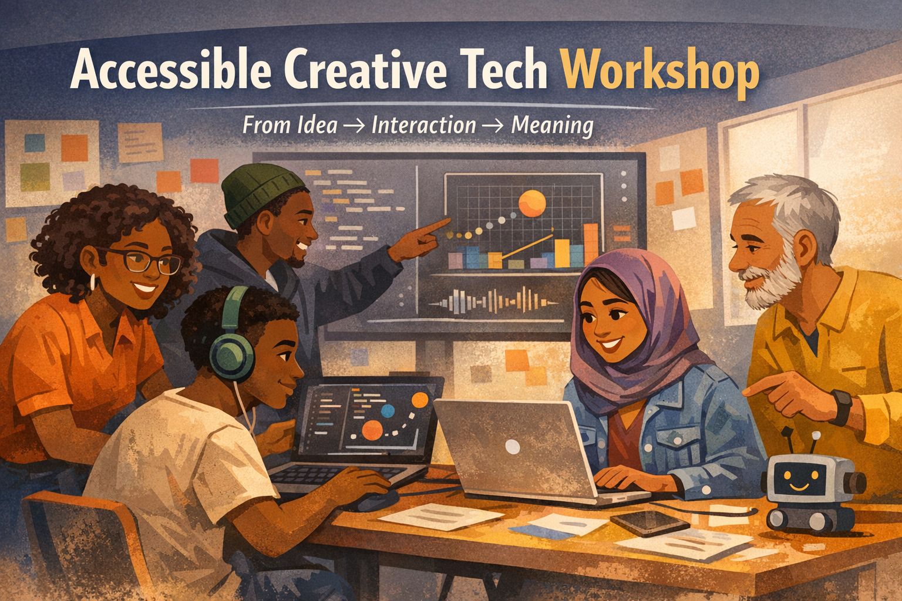
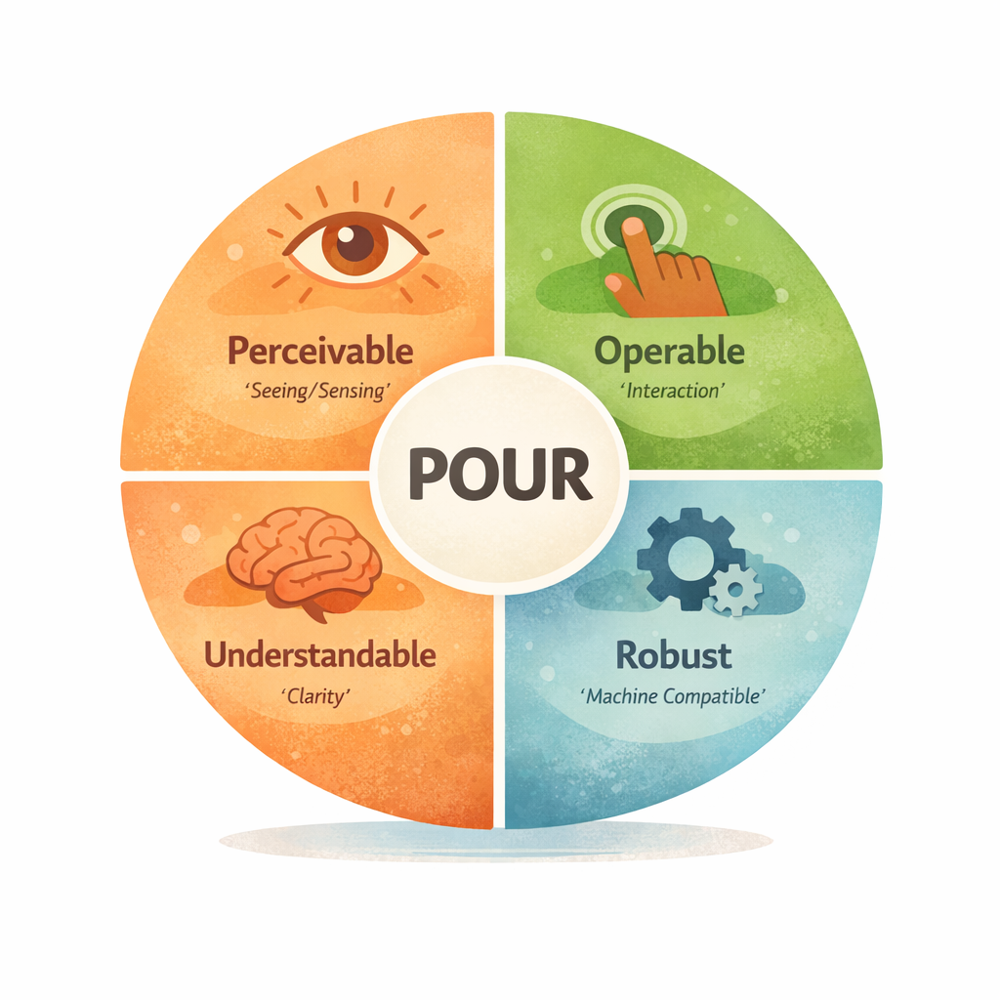
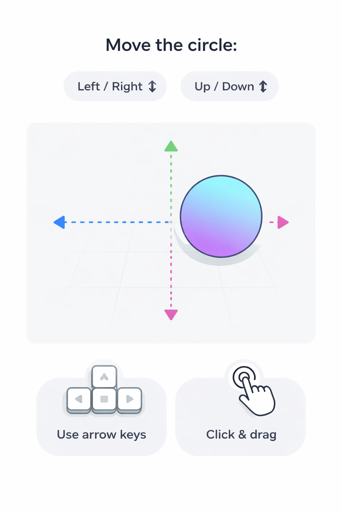

# Accessible by Design: Prototyping Meaning, Not Just Interfaces

> A hands-on workshop on creating simple prototypes and improving them so they are easier to understand, use, and interpret by different people and systems.

---

## Table of Contents

- [What is Digital Accessibility?](#what-is-digital-accessibility)
- [Accessibility Primer](#accessibility-primer)
- [How Content Should Work](#how-content-should-work)
- [Understanding POUR](#understanding-pour)
  - [POUR and Storytelling](#pour-and-storytelling)
  - [Why POUR Matters](#why-pour-matters)
- [Overview](#overview)
- [Core Idea](#core-idea)
- [Thinking in Objects](#thinking-in-objects)
- [Example: Expressing Intent in Code](#example-expressing-intent-in-code)
- [Working with Multiple Elements](#working-with-multiple-elements)
- [Workshop Flow](#workshop-flow)
  - [Discussion](#discussion)
  - [Play (Sketching + Imagination)](#play-sketching--imagination)
- [Example Interaction](#example-interaction)
- [Making Things Easier to Understand and Use](#making-things-easier-to-understand-and-use)
- [Reflection](#reflection)
- [Extend Your Prototype](#extend-your-prototype)
- [Why This Matters](#why-this-matters)
- [References](#references)

---

## What is Digital Accessibility?



Digital accessibility is about designing systems so that more people—and more systems—can use and understand them.  
It means considering different abilities, contexts, and ways of interacting from the very beginning.

This includes people:
- with different physical, sensory, or cognitive abilities  
- using different devices or environments  
- using assistive technologies such as screen readers or keyboard navigation  

It also includes how systems are interpreted by:
- browsers and user agents  
- search systems  
- AI and machine learning tools  

> Can this be understood and used without unnecessary barriers?

---

## Accessibility Primer

Accessibility is not something added at the end.

It begins with clarity.

If someone—or something—has to guess:
- what your system does  
- how to use it  
- what is happening  

then it becomes harder to use.

> Accessibility = making intent clear from the start

---

## How Content Should Work

Content should be:
- perceivable  
- operable  
- understandable  
- robust  

This means it should not depend on a single way of seeing, using, or interpreting it.

---

## Understanding POUR



POUR stands for:
- Perceivable  
- Operable  
- Understandable  
- Robust  

---

### POUR and Storytelling

Think of this like storytelling:

- Who  
- What  
- Where  
- When  
- Why / How  

POUR does the same for systems:

- Perceivable → what is happening  
- Operable → how to use it  
- Understandable → does it make sense  
- Robust → can it work across systems  

---

### Why POUR Matters

POUR helps move from:

> something that works → something that can be understood and used

Learn more:  
https://www.w3.org/WAI/standards-guidelines/wcag/

---

## Overview

This workshop is about prototyping with intention.

You will create a simple prototype and improve it by making it clearer:

- what it is  
- what it does  
- how someone interacts with it  

---

## Core Idea

Make → clarify → expand

---

## Thinking in Objects

Think of what you are building as an object:

- What is it?  
- What does it do?  
- How do you use it?  

---

## Example: Expressing Intent in Code

One way to make intent clearer is through structure.

```javascript
let interactiveObject = {
  name: "movable circle",
  role: "interactive visual element",
  description:
    "A circle that can be moved using keyboard or pointer input.",
  instructions:
    "Use arrow keys or click and drag to move the circle.",
  accessibilitySummary:
    "Supports multiple input methods, provides clear instructions, and gives visual feedback."
};
```

This makes it easier to understand:

- what the system is  
- what it does  
- how to use it  

Even if you are not writing code, this way of thinking applies to:

- sketches  
- diagrams  
- prototypes  

---

## Working with Multiple Elements

Most systems are not made of a single object, but many.

- collections  
- repeated elements  
- variations  

In code → arrays  
In design → patterns or flows  

---

## Workshop Flow

### 1. Make
Create a simple prototype

### 2. Clarify
Improve:
- instructions  
- interaction  
- feedback  

### 3. Expand
Make it usable by more people and systems

---

### Discussion

Participants reflect on:

- what their system does  
- who it is for  
- how it can be understood  

---

### Play (Sketching + Imagination)


Participants explore ideas using:

- pencil and paper  
- diagrams or schematics  
- imagined interactions  

---

## Example Interaction



A simple system demonstrating:
- multiple input methods  
- visible feedback  
- clear interaction  

---

## Making Things Easier to Understand and Use

- What does this do?  
- How does someone know how to use it?  
- Does it respond clearly?  
- Can it be used in more than one way?  
- Could another system understand it?  

Don’t make people guess.

---

## Reflection

> This system allows a user to ______ by ______.

---

## Extend Your Prototype

- clearer instructions  
- alternative inputs  
- multiple elements  
- different contexts  

---

## Why This Matters

When your intent is clear:

- your work becomes easier to understand  
- more people can use it  
- it adapts across contexts  
- it becomes easier for systems to interpret  

Accessible design begins with clarity.

---

## References

These sources distinguish technical accessibility requirements from broader design and governance frameworks.

1. World Wide Web Consortium (W3C). [Web Content Accessibility Guidelines (WCAG) 2.2](https://www.w3.org/TR/WCAG22/). Technical standard for web accessibility.
2. W3C. [Making Content Usable for People with Cognitive and Learning Disabilities](https://www.w3.org/TR/coga-usable/) (Working Group Note, 2021). Supplemental guidance on cognitive accessibility, design patterns, and involving users in design and testing.
3. Hamraie, Aimi, and Kelly Fritsch. [“Crip Technoscience Manifesto”](https://doi.org/10.28968/cftt.v5i1.29607). *Catalyst: Feminism, Theory, Technoscience* 5, no. 1 (2019).
4. Costanza-Chock, Sasha. [*Design Justice: Community-Led Practices to Build the Worlds We Need*](https://designjustice.mitpress.mit.edu/). MIT Press, 2020. Open-access edition.
5. Design Justice Network. [Design Justice Network Principles](https://designjustice.org/read-the-principles).
6. National Institute of Standards and Technology (NIST). [AI Risk Management Framework (AI RMF 1.0)](https://www.nist.gov/itl/ai-risk-management-framework) and [AI RMF Playbook](https://www.nist.gov/itl/ai-risk-management-framework/nist-ai-rmf-playbook). Voluntary AI risk-management resources; the workshop Schema Card is a teaching activity, not a NIST form.
7. [p5.js Reference](https://p5js.org/reference/). Documentation for the creative-coding library used in the workshop.

## Credits

Adekemi (Kemi) Hanna Sijuwade-Ukadike

---

## License

MIT
